<h1>
  <picture>
    <source media="(max-width: 600px)" srcset="assets/profile-banner-mobile.svg">
    
  </picture>
</h1>

## Tech stack

  <picture>
    <source media="(prefers-reduced-motion: reduce)" srcset="assets/skill-badges/javascript.svg#still">
    
  </picture>
  <picture>
    <source media="(prefers-reduced-motion: reduce)" srcset="assets/skill-badges/typescript.svg#still">
    
  </picture>
  <picture>
    <source media="(prefers-reduced-motion: reduce)" srcset="assets/skill-badges/react.svg#still">
    
  </picture>
  <picture>
    <source media="(prefers-reduced-motion: reduce)" srcset="assets/skill-badges/nextdotjs.svg#still">
    
  </picture>
  <picture>
    <source media="(prefers-reduced-motion: reduce)" srcset="assets/skill-badges/vuedotjs.svg#still">
    
  </picture>
  <picture>
    <source media="(prefers-reduced-motion: reduce)" srcset="assets/skill-badges/nuxt.svg#still">
    
  </picture>
  <picture>
    <source media="(prefers-reduced-motion: reduce)" srcset="assets/skill-badges/svelte.svg#still">
    
  </picture>
  <picture>
    <source media="(prefers-reduced-motion: reduce)" srcset="assets/skill-badges/angular.svg#still">
    
  </picture>
  <picture>
    <source media="(prefers-reduced-motion: reduce)" srcset="assets/skill-badges/go.svg#still">
    
  </picture>
  <picture>
    <source media="(prefers-reduced-motion: reduce)" srcset="assets/skill-badges/nodedotjs.svg#still">
    
  </picture>
  <picture>
    <source media="(prefers-reduced-motion: reduce)" srcset="assets/skill-badges/nestjs.svg#still">
    
  </picture>
  <picture>
    <source media="(prefers-reduced-motion: reduce)" srcset="assets/skill-badges/express.svg#still">
    
  </picture>
  <picture>
    <source media="(prefers-reduced-motion: reduce)" srcset="assets/skill-badges/python.svg#still">
    
  </picture>
  <picture>
    <source media="(prefers-reduced-motion: reduce)" srcset="assets/skill-badges/php.svg#still">
    
  </picture>
  <picture>
    <source media="(prefers-reduced-motion: reduce)" srcset="assets/skill-badges/cplusplus.svg#still">
    
  </picture>
  <picture>
    <source media="(prefers-reduced-motion: reduce)" srcset="assets/skill-badges/android.svg#still">
    
  </picture>
  <picture>
    <source media="(prefers-reduced-motion: reduce)" srcset="assets/skill-badges/flutter.svg#still">
    
  </picture>
  <picture>
    <source media="(prefers-reduced-motion: reduce)" srcset="assets/skill-badges/dart.svg#still">
    
  </picture>
  <picture>
    <source media="(prefers-reduced-motion: reduce)" srcset="assets/skill-badges/postgresql.svg#still">
    
  </picture>
  <picture>
    <source media="(prefers-reduced-motion: reduce)" srcset="assets/skill-badges/mysql.svg#still">
    
  </picture>
  <picture>
    <source media="(prefers-reduced-motion: reduce)" srcset="assets/skill-badges/mariadb.svg#still">
    
  </picture>
  <picture>
    <source media="(prefers-reduced-motion: reduce)" srcset="assets/skill-badges/linux.svg#still">
    
  </picture>
  <picture>
    <source media="(prefers-reduced-motion: reduce)" srcset="assets/skill-badges/docker.svg#still">
    
  </picture>
  <picture>
    <source media="(prefers-reduced-motion: reduce)" srcset="assets/skill-badges/kubernetes.svg#still">
    
  </picture>
  <picture>
    <source media="(prefers-reduced-motion: reduce)" srcset="assets/skill-badges/dokploy.svg#still">
    
  </picture>
  <picture>
    <source media="(prefers-reduced-motion: reduce)" srcset="assets/skill-badges/traefikproxy.svg#still">
    
  </picture>
  <picture>
    <source media="(prefers-reduced-motion: reduce)" srcset="assets/skill-badges/nginx.svg#still">
    
  </picture>
  <picture>
    <source media="(prefers-reduced-motion: reduce)" srcset="assets/skill-badges/ci-cd.svg#still">
    
  </picture>
  <picture>
    <source media="(prefers-reduced-motion: reduce)" srcset="assets/skill-badges/prometheus.svg#still">
    
  </picture>
  <picture>
    <source media="(prefers-reduced-motion: reduce)" srcset="assets/skill-badges/grafana.svg#still">
    
  </picture>
  <picture>
    <source media="(prefers-reduced-motion: reduce)" srcset="assets/skill-badges/elasticsearch.svg#still">
    
  </picture>
  <picture>
    <source media="(prefers-reduced-motion: reduce)" srcset="assets/skill-badges/logstash.svg#still">
    
  </picture>
  <picture>
    <source media="(prefers-reduced-motion: reduce)" srcset="assets/skill-badges/kibana.svg#still">
    
  </picture>
  <picture>
    <source media="(prefers-reduced-motion: reduce)" srcset="assets/skill-badges/git.svg#still">
    
  </picture>
  <picture>
    <source media="(prefers-reduced-motion: reduce)" srcset="assets/skill-badges/gnubash.svg#still">
    
  </picture>
  <picture>
    <source media="(prefers-reduced-motion: reduce)" srcset="assets/skill-badges/redis.svg#still">
    
  </picture>

## GitHub stats

<picture>
  <source media="(max-width: 600px)" srcset="assets/github-activity-mobile.svg">
  
</picture>
