<h1>
  <picture>
    <source media="(max-width: 600px)" srcset="assets/profile-banner-mobile.svg">
    
  </picture>
</h1>

## Tech stack

  
  
  
  
  
  
  
  
  
  
  
  
  
  
  
  
  
  
  
  
  
  
  
  
  
  
  
  
  
  
  
  
  
  
  
  

## GitHub stats

<picture>
  <source media="(max-width: 600px)" srcset="assets/github-activity-mobile.svg">
  
</picture>
